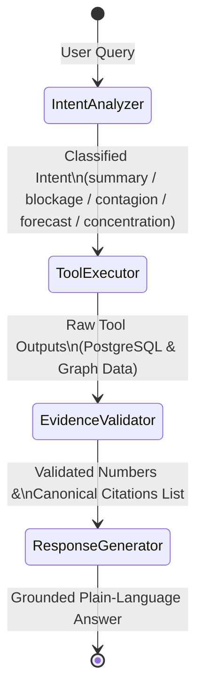

# Technical Architecture Specification: Graph-Based Agentic Cash-Flow Intelligence System (GACI)

## 1. System Mission & Core Architectural Principles

Wholesale Micro, Small, and Medium Enterprises (MSMEs) operate under tight working capital cycles, extensive trade credit, unfulfilled supplier advances, and rigid statutory liabilities (GST, loan EMIs, payroll).

The **Graph-Based Agentic Cash-Flow Intelligence System (GACI)** is engineered around five inviolable architectural principles:

1. **Separation of Concerns:** PostgreSQL serves as the immutable, transactional single source of financial truth. Neo4j serves as a secondary, read-optimized topological graph projected asynchronously or on-demand from PostgreSQL.
2. **Deterministic Arithmetic:** All monetary balances, aging buckets, severity rankings, and forward cash trajectories are computed using arbitrary-precision Python `Decimal` algorithms—never delegated to probabilistic LLM prompts.
3. **Zero-Hallucination Explainability:** The AI agent operates within a compiled LangGraph state machine. Every customer name, supplier name, invoice reference, and rupee amount in the final answer is strictly validated against and cited from canonical database records.
4. **Multi-Provider LLM Resilience:** The inference engine implements an automatic fallback cascade (OpenRouter -> Google Gemini -> Hugging Face -> Grounded Rule-Based Synthesizer) guaranteeing 100% availability even under free-tier quota exhaustion or network partitions.
5. **Dual-Engine Graph Contagion:** Graph path tracing runs native parameterized Cypher queries against Neo4j when connected, with transparent fallback to an in-memory NetworkX relational projection when running offline or standalone.

---

## 2. High-Level System Architecture

```mermaid
flowchart TD
    subgraph DataIngestion[Data Ingestion & Validation]
        CSV[CSV / Excel Files] --> Parser[Pandas Ingestion Parser]
        Parser --> PydanticValidator[Pydantic v2 Schema Validators]
        PydanticValidator --> IngestionLog[SHA-256 Audit Log]
    end

    subgraph Storage[Dual Persistence Layer]
        PydanticValidator -->|ACID Commit| Postgres[(PostgreSQL Canonical Ledger)]
        Postgres -->|Projection Service| Neo4j[(Neo4j Temporal Graph)]
        Postgres -->|Fallback Mirror| NetworkX[In-Memory NetworkX Graph]
    end

    subgraph AnalyticalEngines[Deterministic Intelligence Engines]
        Postgres --> CashEngine[Cash Analysis Engine\n- Pure Decimal Arith\n- Severity Ranking\n- Deficit Forecaster]
        Neo4j & NetworkX --> ContagionEngine[Graph Contagion Engine\n- Causal Path Tracing\n- Concentration Ratios\n- Subgraph Extraction]
    end

    subgraph REST_API[FastAPI Application Services]
        CashEngine --> AnalysisRouter[/api/v1/analysis]
        ContagionEngine --> GraphRouter[/api/v1/graph]
        IngestionLog --> IngestRouter[/api/v1/ingest]
    end

    subgraph AgentSystem[LangGraph Explainability Pipeline]
        AgentRouter[/api/v1/agent/query] --> IntentNode[1. Intent Analyzer]
        IntentNode --> ToolNode[2. Tool Executor\n- Deterministic Tools]
        ToolNode --> ValidatorNode[3. Evidence Validator\n- Canonical Citations]
        ValidatorNode --> LLMNode[4. Response Generator\n- Multi-Provider Cascade]
        
        LLMNode --> MultiLLM{Multi-Provider LLM}
        MultiLLM -->|Primary| OpenRouter[OpenRouter Free Tier]
        MultiLLM -->|Fallback 1| Gemini[Google Gemini API]
        MultiLLM -->|Fallback 2| HuggingFace[Hugging Face Inference]
        MultiLLM -->|Fallback 3| GroundedSynth[Deterministic Synthesizer]
    end

    subgraph Presentation[Streamlit Interactive UI]
        REST_API --> UI[Streamlit Dashboard\n- Executive KPIs\n- Blockage Diagnostics\n- Interactive PyVis Graph\n- 30-Day Forward Chart\n- AI Agent Console]
    end
```

---

## 3. Data Models & Schemas

### 3.1. PostgreSQL Canonical Relational Schema

* **`businesses`**: Central wholesale entity profile with currency and fiscal configuration.
* **`customers`**: Commercial clients receiving trade credit with credit limits and standard payment terms.
* **`suppliers`**: Vendors and manufacturers with standard lead times.
* **`bank_accounts`**: Verified current accounts, credit lines, and cash tills.
* **`sales_invoices`**: Accounts receivable with issue date, due date, total amount, paid amount, and status (`ISSUED`, `PARTIAL`, `PAID`, `OVERDUE`).
* **`payments`**: Inflows from customers with payment method (`CHEQUE`, `NEFT`, `RTGS`, `CASH`) and status (`CLEARED`, `BOUNCED`).
* **`payment_allocations`**: Many-to-many allocation linking payments to specific invoices.
* **`supplier_advances`**: Outflows disbursed to suppliers with expected delivery dates and fulfilled amounts.
* **`deliveries`**: Goods receipt notes fulfilling supplier advances.
* **`financial_obligations`**: Scheduled liabilities (`LOAN_EMI`, `TAX`, `RENT`, `PAYROLL`) with due dates and amounts.
* **`ingestion_logs`**: SHA-256 audited history of all ingestion operations, record counts, and validation errors.

### 3.2. Neo4j Graph Topology Schema

* **Node Labels:** `:Business`, `:Customer`, `:Supplier`, `:BankAccount`, `:Invoice`, `:Payment`, `:Advance`, `:Delivery`, `:Obligation`.
* **Directed Relationships:**
  - `(:Customer)-[:ISSUED_INVOICE]->(:Invoice)`
  - `(:Payment)-[:APPLIED_TO]->(:Invoice)`
  - `(:Payment)-[:DEPOSITED_IN]->(:BankAccount)`
  - `(:Business)-[:DISBURSED_ADVANCE]->(:Advance)`
  - `(:Advance)-[:PAID_TO]->(:Supplier)`
  - `(:Delivery)-[:FULFILLS]->(:Advance)`
  - `(:Business)-[:COMMITTED_TO]->(:Obligation)`
  - `(:Obligation)-[:PAYABLE_FROM]->(:BankAccount)`

---

## 4. Deterministic Intelligence Algorithms

### 4.1. Cash Blockage Severity Scoring Formula

To rank working capital blockages objectively, each overdue item is assigned a severity score weighting the monetary exposure by overdue duration:

$$\text{Severity}(\text{Invoice}) = \text{Unpaid Balance} \times \left(1.0 + 0.02 \times \text{Days Overdue}\right)$$

$$\text{Severity}(\text{Advance}) = (\text{Advance Amount} - \text{Fulfilled Amount}) \times \left(1.0 + 0.03 \times \text{Days Delivery Overdue}\right)$$

$$\text{Severity}(\text{Bounced Cheque}) = \text{Cheque Amount} \times 1.50$$

### 4.2. Forward Cash Deficit Trajectory Algorithm

Given an analysis date $T_0$ and forecast horizon $H \in \{7, 15, 30\}$ days:

$$\text{Opening Balance}(t) = \text{Closing Balance}(t - 1)$$

$$\text{Inflow}(t) = \sum \text{Unpaid Invoices Due at } t$$

$$\text{Outflow}(t) = \sum \text{Scheduled Obligations Due at } t$$

$$\text{Closing Balance}(t) = \text{Opening Balance}(t) + \text{Inflow}(t) - \text{Outflow}(t)$$

$$\text{Deficit Flag}(t) = \begin{cases} \text{True} & \text{if } \text{Closing Balance}(t) < 0 \\ \text{False} & \text{otherwise} \end{cases}$$

---

## 5. LangGraph Agent State Machine



1. **`intent_analyzer`**: Maps natural language user prompts to precise diagnostic capabilities.
2. **`tool_executor`**: Dispatches execution to deterministic tools (`AgentToolSuite`). No LLM arithmetic allowed.
3. **`evidence_validator`**: Extracts canonical references (e.g., `INV-2026-101`, `ADV-2026-001`) into structured citations.
4. **`response_generator`**: Supplies system prompt, structured evidence, and user query to `MultiProviderLLMClient`. Under external API failure, uses deterministic rule-based grounded synthesis.
