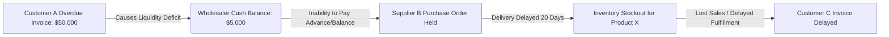
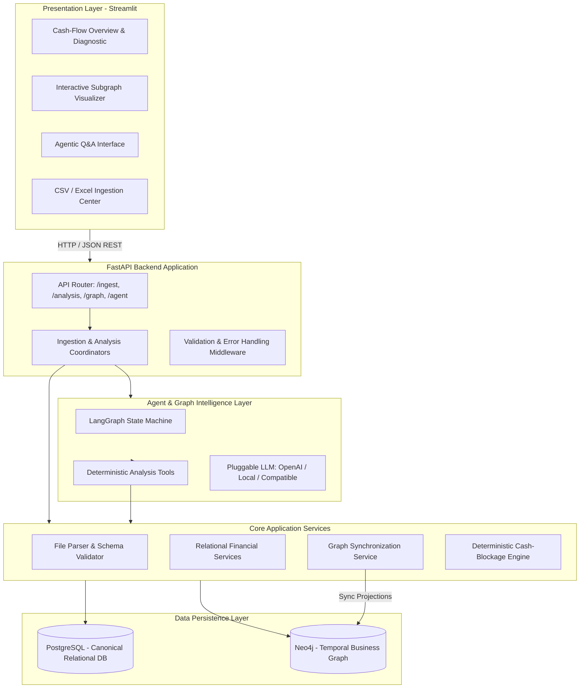
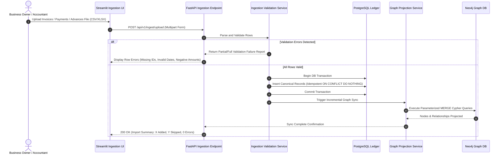
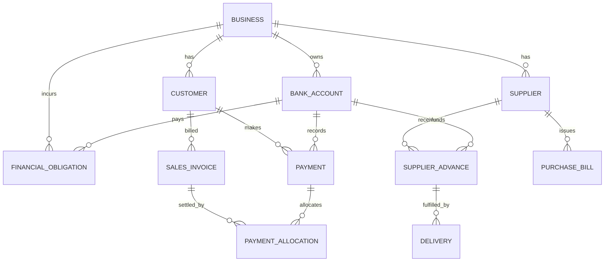
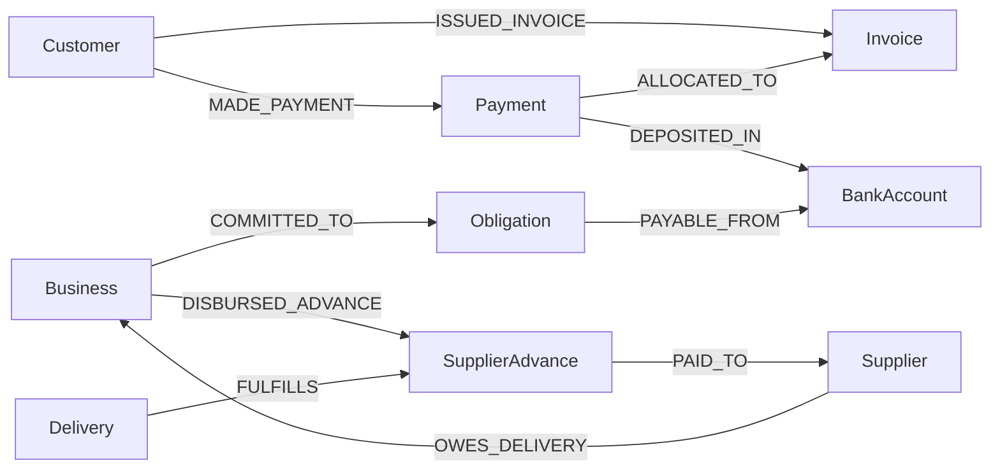
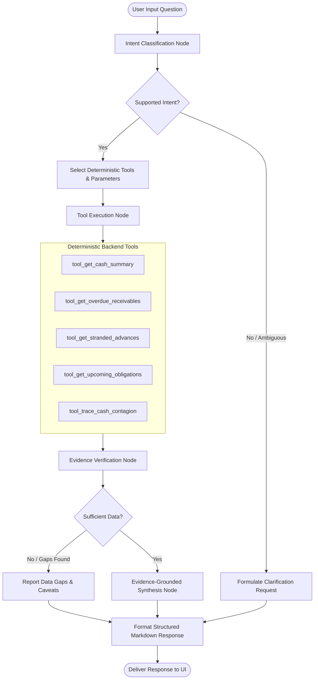

# PROJECT_SOURCE.md — System Specification

**Project Title:** Graph-Based Agentic Cash-Flow Intelligence System for Small Wholesale MSMEs  
**Alternative Title:** An Agentic Cash-Flow Intelligence System for Detecting and Managing Working-Capital Blockages Using Temporal Business Graphs  
**Status:** DRAFT BASELINE (Awaiting User Review & Approval)  
**Primary Domain:** Working-Capital & Cash-Flow Intelligence for Wholesale Micro, Small, and Medium Enterprises (MSMEs)  

---

## 1. Executive Summary

Small wholesale MSMEs routinely experience acute liquidity and cash shortages despite robust top-line sales, substantial inventory, and a thriving customer base. In wholesale operations, cash does not simply vanish; it becomes stranded across disjoint operational nodes—trapped in overdue customer credit (accounts receivable), locked in unfulfilled supplier advances, encumbered by slow-moving inventory batches, or threatened by imminent financial commitments (tax payments, debt obligations, rent) falling due before expected customer receivables settle.

Traditional accounting software (e.g., Tally, Zoho Books, QuickBooks) provides flat ledgers, tabular age-analysis, and static balance sheets, but fails to model the causal and temporal interdependence between interconnected transactions. A delayed receivable from Customer A directly starves the working capital required to pay Supplier B, which halts Goods Delivery C, subsequently delaying fulfillment to Customer D.

The **Graph-Based Agentic Cash-Flow Intelligence System** resolves this fundamental disconnect by modeling business operations as a **time-aware, multi-relational Business Graph** grounded in canonical transactional records. By projecting double-entry relational records (PostgreSQL) into a directed temporal graph (Neo4j), the system enables a specialized **Cash-Flow Intelligence Agent** (orchestrated via LangGraph) to deterministically analyze working capital, trace causal propagation paths of cash blockages, prioritize financial bottlenecks, and deliver verifiable, evidence-grounded explanations to the business owner.

This system is strictly a **decision-support intelligence platform**. It is not an autonomous payment system, bank integration, tax compliance tool, or generic AI chatbot.

---

## 2. Problem Statement & Real-World Business Context

### 2.1 Wholesale MSME Dynamics
Wholesale businesses operate on tight working-capital margins, high transaction volumes, and widespread credit arrangements:
1. **Unsecured Trade Credit:** Goods are shipped with 30-to-90 day credit terms. Late customer payments are endemic.
2. **Cheque Dishonor (Bounced Cheques):** Customers issue post-dated or current cheques that fail clearance due to insufficient funds, creating phantom liquidity.
3. **Supplier Advances:** To secure bulk inventory or scarce commodities, wholesalers pay cash advances before goods dispatch. If suppliers delay delivery, cash is locked without inventory turnover.
4. **Dead / Stagnant Stock:** Cash committed to slow-moving inventory generates holding costs and cannot be liquidated quickly without steep discounting.
5. **Cash Flow Timing Mismatches:** Wholesaler obligations (loan EMIs, payroll, supplier bills) have hard deadlines that do not flex when customer receivables are delayed.
6. **Siloed Records:** Wholesalers track sales in billing software, bank balances via passbooks, customer reminders via messaging apps, and supplier orders on paper, preventing a connected overview of financial health.

### 2.2 The Cascading Liquidity Contagion
Cash blockage is inherently a network phenomenon:


### 2.3 The Central Architectural Insight
To accurately reason about this contagion, the system projects canonical relational records into a **Temporal Business Graph** with three non-negotiable operational principles:
1. **Distinguish Flow Semantics:** Actual cash movements, expected receivables, committed liabilities, and physical goods transfers must never be conflated.
2. **Canonical Relational Ledger:** PostgreSQL is the single source of truth for accounting records, ledger balances, and auditability. The graph database (Neo4j) is a read-optimized projection for relationship traversal, contagion tracing, and topological bottleneck identification.
3. **Deterministic Reasoning Over Generative Hallucination:** The AI Agent never invents numbers, predicts ledger entries, or calculates balances via LLM prompt weights. It relies on deterministic tools, graph queries, and arithmetic algorithms, using the LLM exclusively for semantic intent classification, tool invocation planning, and synthesizing evidence-grounded explanations.

---

## 3. Target Users & Intended Usage

### 3.1 Target Users
* **Wholesale Business Owners / Proprietors:** Non-technical operators who need clear, jargon-free explanations of why available cash is low and which customers or suppliers require immediate intervention.
* **Internal Accountants / Operations Managers:** Professionals who import daily/weekly transaction registers, review reconciliation discrepancies, and verify graph projections against trial balances.

### 3.2 Intended Usage Workflows
1. **Batch Import & Ingestion:** The user uploads standard CSV or Excel exports from their billing or accounting software (Invoices, Payments, Advances, Deliveries, Obligations).
2. **Daily Liquidity & Blockage Diagnostic:** The owner opens the dashboard to inspect the current cash position, overdue receivables, unfulfilled supplier advances, and imminent payment pressures within customizable forward-looking windows (e.g., 7, 15, 30 days).
3. **Conversational Root-Cause Investigation:** The owner asks natural-language questions through the chat interface to trace why a cash shortfall is occurring and what evidence supports the conclusion.
4. **Visual Relationship Inspection:** The user inspects interactive graph subgraphs to visually explore connections between overdue invoices, affected bank balances, and delayed supplier deliveries.

---

## 4. Business Objectives & Measurable Success Criteria

### 4.1 Objectives
1. Provide a unified, time-aware view connecting customers, suppliers, bank accounts, invoices, payments, advances, deliveries, and obligations.
2. Ingest, validate, and persist tabular business data with comprehensive error handling and audit logging.
3. Automatically detect, categorize, and quantify cash blockages across accounts receivable, supplier advances, and payment timing mismatches.
4. Enable an agentic question-answering workflow grounded strictly in database facts.
5. Provide a responsive, local-first interactive dashboard and graph visualization.

### 4.2 Measurable Success Criteria
* **Data Integrity:** 100% of persisted financial records in PostgreSQL reconcile with original valid import records.
* **Projection Consistency:** Zero orphan graph nodes or unlinked relationships; all graph entities map 1:1 to canonical UUIDs in PostgreSQL.
* **Zero Hallucination of Core Facts:** 0% occurrence of fictitious amounts, dates, entities, or statuses in agent responses during regression testing.
* **Idempotent Ingestion:** Safely re-importing the same CSV/Excel file results in zero duplicate financial transactions or double-counted balances.
* **Sub-Second Deterministic Analysis:** Core financial summaries and graph blockage queries execute in under 1 second for datasets up to 100,000 transactions.
* **Evidence Grounding:** Every insight reported by the agent cites specific canonical record IDs, transaction timestamps, and exact mathematical derivations.

---

## 5. Functional Requirements

### FR-1: Data Ingestion & Validation
* Support multi-table ingestion from CSV and Excel (`.xlsx`, `.xls`) formats covering:
  - Parties (Customers, Suppliers)
  - Invoices (Sales Invoices, Purchase Bills)
  - Payments & Receipts (Bank, Cash, Cheque, UPI, NEFT/RTGS)
  - Cheque Status Records (Issued, Deposited, Cleared, Bounced)
  - Supplier Advances & Purchase Orders
  - Delivery Challans / Goods Receipt Notes (GRN)
  - Financial Obligations (Loans, Rent, Tax, Payroll)
  - Bank and Cash Accounts with opening balances
* Validate column schemas, strict data types, non-null constraints, and date-time chronological validity (e.g., `due_date >= issue_date`).
* Generate row-by-row validation error reports detailing rejected rows and rejection reasons without halting partial valid batches unless transactional atomicity is required.
* Prevent duplicate transaction imports using unique composite idempotency keys (e.g., `party_id` + `invoice_number` or `bank_id` + `transaction_ref`).

### FR-2: Canonical Relational Persistence (PostgreSQL)
* Store normalized, ACID-compliant records using SQLAlchemy ORM and Alembic migrations.
* Maintain double-entry alignment for payments against invoices (allocations).
* Track full lifecycle state transitions:
  - Invoice: `ISSUED` -> `PARTIALLY_PAID` -> `PAID` -> `OVERDUE` -> `CANCELLED` -> `WRITTEN_OFF`
  - Cheque / Transaction: `INITIATED` -> `CLEARED` -> `BOUNCED` -> `REVERSED`
  - Supplier Advance: `DISBURSED` -> `PARTIALLY_DELIVERED` -> `FULLY_DELIVERED` -> `REFUNDED`
  - Obligation: `SCHEDULED` -> `DUE` -> `SETTLED` -> `DEFAULTED`

### FR-3: Temporal Graph Projection (Neo4j)
* Project entities and relationships idempotently into Neo4j using parameterized Cypher.
* Maintain stable UUID mapping between PostgreSQL primary keys and Neo4j node properties.
* Support bidirectional graph navigation while strictly preserving edge direction and semantics.
* Graph synchronization service capable of full projection rebuilds and incremental change sync.

### FR-4: Deterministic Cash-Blockage & Financial Analysis
* Calculate exact metrics:
  - **Available Liquid Cash:** Sum of verified cleared bank balances and cash-on-hand.
  - **Overdue Accounts Receivable (A/R):** Invoices with unpaid balances past `due_date`, categorized into aging buckets (1-30, 31-60, 61-90, 90+ days).
  - **Stranded Supplier Advances:** Advances disbursed where goods have not been received past `expected_delivery_date`.
  - **Dishonored / Bounced Cheque Exposure:** Reconciled payments marked `BOUNCED` that revert invoices to unpaid status.
  - **Upcoming Cash-Pressure Deficit:** Projected cash gap within window $T$:
    $$\text{Projected Cash}(T) = \text{Liquid Cash} + \sum \text{Expected Receipts}(T) - \sum \text{Committed Obligations}(T)$$
  - **Bottleneck Prioritization Scoring:** Transparent composite scoring based on overdue magnitude, aging, customer concentration risk, and direct connection to imminent obligations.

### FR-5: Graph Intelligence & Path Tracing
* Execute targeted Cypher queries to:
  - Trace paths from overdue receivables to impending unpaid supplier invoices or loan defaults.
  - Detect circular credit dependencies (Customer owes Wholesaler, Wholesaler owes Supplier, Supplier owes Customer).
  - Calculate party concentration risk (top 20% parties holding > 80% blocked capital).

### FR-6: Stateful Agent Orchestration (LangGraph)
* Provide a LangGraph workflow featuring:
  - Query Intent Classification (Overdue Inquiries, Root-Cause Tracing, Cash-Flow Forecast, Entity Deep-Dives).
  - Parameter Extraction & Validation (date ranges, party names, thresholds).
  - Tool Invocation targeting deterministic backend services (Relational & Graph).
  - Evidence Sufficiency Verification (verifying data completeness before formulating answers).
  - Structured Response Generation (Facts, Evidence, Derivation, Caveats, Recommended Next Checks).

### FR-7: Owner Dashboard & Interactive Visualization (Streamlit)
* Executive Summary Cards: Cleared Cash, Overdue Receivables, Trapped Advances, 15-Day Obligation Gap.
* Blockage Diagnostic Table with sorting, filtering, and deep-dive inspection.
* Dynamic Graph Subgraph Viewer using PyVis or Cytoscape with node coloring by entity type and edge styling by flow category.
* Chat Interface with conversational history, tool call trace inspection, and evidence citation links.
* Ingestion Center with drag-and-drop file upload, schema feedback, and error logs.

---

## 6. Non-Functional Requirements

* **Local-First Deployment:** The entire system must execute locally on Windows/Linux/macOS with local PostgreSQL and local Neo4j instances. No cloud infrastructure required for baseline operation.
* **Deterministic Financial Correctness:** Financial arithmetic must use arbitrary-precision decimals (`Decimal` in Python, `NUMERIC(15, 2)` in PostgreSQL). Floating-point arithmetic is prohibited for currency.
* **Idempotency & Re-entrancy:** Re-running data migrations, graph projections, or batch imports must produce identical, consistent states without duplication.
* **Auditability & Traceability:** All agent responses must cite specific database records. Every graph node must reference its PostgreSQL table and primary key.
* **Security & Privacy:** Environment variables manage secrets (`.env`). No cleartext passwords or API keys committed to source control. Parameterized queries enforce protection against SQL/Cypher injection.
* **Maintainability & Clean Architecture:** Separation of concerns across API, Service, Repository, Graph, Analysis, and UI layers. Comprehensive unit and integration test coverage.

---

## 7. Explicit Scope Boundaries & Non-Goals

### Strict Non-Goals (Out of Scope for Initial Scope)
1. **No Autonomous Financial Execution:** The system shall never initiate payments, wire transfers, automated bank debits, or send legal collection notices autonomously.
2. **No Live Banking Open-API / Direct Plaid Integrations:** Real-time bank feeds are out of scope. Ingestion operates via file-based statements and ledgers.
3. **No Tax Compliance or Regulatory Filing:** The system does not compute GST/VAT returns, generate tax invoices, or interface with government tax portals.
4. **No Full-Fledged ERP / Inventory Management:** Inventory items are tracked only in the context of tied-up capital and delivery fulfillment against advances, not warehouse shelf-location tracking or barcode scanning.
5. **No Cloud-Only SaaS Deployments:** Multi-tenant SaaS architecture, Kubernetes clusters, and cloud IAM are excluded.
6. **No Speculative Unconstrained LLM Forecasting:** The system will not use LLMs to guess future sales curves or hallucinate macro-economic scenarios.

---

## 8. Core Business Concepts & Terminology

| Concept | Definition & Operational Meaning |
| :--- | :--- |
| **Wholesaler (MSME)** | The focal business whose cash flow, working capital, and relationships are modeled. |
| **Customer** | An external entity that purchases wholesale goods on cash or credit terms. |
| **Supplier / Vendor** | An external entity supplying raw materials or trade merchandise. |
| **Sales Invoice** | A commercial claim issued to a customer detailing goods sold, total value, and payment due date. |
| **Overdue Invoice** | An unpaid invoice whose calendar due date is strictly earlier than the current analysis date. |
| **Supplier Advance** | Cash disbursed to a supplier before goods are delivered, creating a temporary delivery obligation on the supplier. |
| **Delivery Challan / GRN**| Proof of physical transfer of goods fulfilling an invoice or advance. |
| **Bounced Cheque** | A payment instrument deposited into the bank that was dishonored, reverting the payment and reinstating the liability. |
| **Financial Obligation**| A non-invoice mandatory cash outflow (e.g., loan EMI, payroll, warehouse rent, tax). |
| **Actual Cash Flow** | Cash that has definitively cleared the bank or is physically held in the verified cash till. |
| **Expected Cash Flow** | Legally recognized receivables that are contractually due but not yet settled. |
| **Committed Cash Flow**| Scheduled future cash outflows required to service contracts, debt, or operating expenses. |
| **Temporal Business Graph**| A graph database where nodes represent entities/transactions and edges capture financial, contractual, or physical relationships with explicit time stamps. |

---

## 9. Supported User Questions & Expected Agent Behavior

The primary Cash-Flow Intelligence Agent must answer targeted questions with grounded evidence:

| User Question | Analytical Process | Required Output & Evidence |
| :--- | :--- | :--- |
| *"Where is my money currently blocked?"* | Runs global blockage diagnostic across A/R, advances, and bounced cheques. Groups by category. | Summary of trapped funds by bucket, ranked by amount, citing top counterparties and record IDs. |
| *"Why is cash low even though sales this month are high?"* | Compares total sales invoiced vs. cleared cash collections. Analyzes unpaid sales invoices and inventory/supplier advance lockups. | Demonstrates that revenue is locked in receivables (A/R) or advances; cites cleared collections vs. paper revenue. |
| *"Which customers have the largest overdue balances?"* | Queries PostgreSQL/Neo4j for overdue invoices grouped by customer. Calculates overdue days. | Ranked table of customers, total overdue amount, oldest invoice date, and invoice ID references. |
| *"What supplier advances are still awaiting delivery?"* | Traverses `ADVANCED_CASH` edges without matching `FULFILLED_BY` delivery edges past expected delivery date. | List of suppliers, advance dates, disbursed amounts, overdue delivery days, and Purchase Order numbers. |
| *"Which upcoming payments create the greatest cash-pressure risk?"* | Projects daily net cash over 7/15/30 days. Compares available liquid cash against scheduled obligations. | Day-by-day cash projection, date of projected insolvency/shortfall, specific obligations triggering the deficit. |
| *"Which overdue receipts are connected to my upcoming loan payment?"* | Traces dependency paths in Neo4j from overdue customer invoices to the bank account servicing the loan obligation. | Path explanation showing which specific overdue customer invoices would cover the loan EMI deficit. |

---

## 10. System Architecture & Component Responsibilities

The system adheres to a layered, modular architecture:



### Component Breakdown
1. **Presentation Layer (Streamlit):** Web UI displaying KPI cards, interactive blockage grids, graph visualizer (PyVis), and conversational agent console.
2. **Backend API (FastAPI):** High-performance asynchronous REST endpoints validating payloads with Pydantic v2.
3. **Agent Orchestration (LangGraph):** State-machine workflow coordinating intent classification, tool invocation, evidence checks, and grounding.
4. **Deterministic Analysis Engine:** Pure Python/SQL mathematical modules for A/R aging, advance aging, and cash projection.
5. **Graph Projection Service:** Idempotent synchronizer mapping relational records into Neo4j graph nodes and edges.
6. **Canonical Storage:** PostgreSQL holding relational tables; Neo4j holding graph projections.

---

## 11. Technology Stack & Rationale

| Layer | Selected Technology | Version / Requirement | Rationale |
| :--- | :--- | :--- | :--- |
| **Language** | Python | 3.10+ | Industry standard for data engineering, AI agents, and rapid development. |
| **API Framework** | FastAPI | 0.110+ | High-speed, async support, auto-generated OpenAPI documentation, strict Pydantic v2 validation. |
| **Relational ORM** | SQLAlchemy | 2.0+ | Modern type-safe 2.0 syntax, robust transaction management, database independence. |
| **Database Migrations** | Alembic | 1.13+ | Version-controlled, reproducible relational database schema evolution. |
| **Relational DB** | PostgreSQL | 14+ | ACID compliance, arbitrary-precision numeric types, battle-tested financial integrity. |
| **Graph Database** | Neo4j Community | 5.x | Native graph storage, indexed Cypher query language, multi-hop path traversal capabilities. |
| **Graph Driver** | neo4j Python Driver | 5.x | Official, performant binary Bolt protocol driver with transaction support. |
| **Agent Framework** | LangGraph | 0.0.30+ | Cyclical state-machine graph execution, reliable tool-calling patterns, checkpointing. |
| **LLM Interface** | LangChain Core / OpenAI | Pluggable | Clean abstraction supporting OpenAI API or local models (via Ollama / vLLM). |
| **Frontend UI** | Streamlit | 1.32+ | Rapid, Python-native dashboard and chat UI development. |
| **Graph Visualization**| PyVis / Cytoscape | HTML/JS integration | Interactive physics-driven graph exploration embedded directly in Streamlit. |
| **Testing** | Pytest, Pytest-Asyncio | Latest | Comprehensive test execution with fixtures, mocking, and coverage analysis. |

---

## 12. Data Ingestion & Validation Workflow



### Ingestion Validation Rules:
* **Duplicate Protection:** Invoices must have unique `(business_id, invoice_number)`. Payments must have unique `(business_id, reference_number)`.
* **Chronological Integrity:** `invoice_date <= due_date`. `payment_date >= invoice_date` (except authorized customer advance payments).
* **Currency & Value Sanitization:** No negative amounts; amounts rounded to two decimal places.

---

## 13. Relational Database Responsibilities (PostgreSQL Schema)

PostgreSQL stores canonical records. All financial amounts use `NUMERIC(15, 2)`.



### Core Relational Tables:
1. `businesses`: Internal company profile, currency, fiscal year.
2. `customers`: Name, credit limit, standard payment terms (days), contact.
3. `suppliers`: Name, standard lead time (days), contact.
4. `bank_accounts`: Account number, bank name, account type (`BANK`, `CASH`), verified balance.
5. `sales_invoices`: Invoice number, customer UUID, issue date, due date, total amount, paid amount, status (`ISSUED`, `PARTIAL`, `PAID`, `OVERDUE`, `CANCELLED`).
6. `payments`: Payment reference, party UUID, bank account UUID, amount, date, method (`CASH`, `CHEQUE`, `NEFT`, `UPI`), status (`INITIATED`, `CLEARED`, `BOUNCED`).
7. `payment_allocations`: Links payment UUID to sales invoice UUID with allocated amount.
8. `supplier_advances`: Advance reference, supplier UUID, bank account UUID, amount, disbursement date, expected delivery date, fulfilled amount, status (`DISBURSED`, `PARTIAL_DELIVERED`, `FULFILLED`).
9. `deliveries`: Delivery Challan reference, supplier UUID, advance UUID, delivery date, delivered value.
10. `financial_obligations`: Obligation name, category (`LOAN_EMI`, `RENT`, `TAX`, `PAYROLL`), due date, amount, recipient, status (`SCHEDULED`, `PAID`, `OVERDUE`).
11. `ingestion_logs`: File name, upload timestamp, row count, status, error details.

---

## 14. Graph Database Responsibilities (Neo4j Schema)

Neo4j projects entities as nodes and operations as edges to support temporal multi-hop graph queries.

### 14.1 Node Labels & Properties
* `(:Business {id: UUID, name: STRING})`
* `(:Customer {id: UUID, name: STRING, credit_limit: FLOAT})`
* `(:Supplier {id: UUID, name: STRING})`
* `(:Invoice {id: UUID, invoice_number: STRING, amount: FLOAT, unpaid_balance: FLOAT, issue_date: DATE, due_date: DATE, status: STRING})`
* `(:Payment {id: UUID, ref: STRING, amount: FLOAT, payment_date: DATE, status: STRING, method: STRING})`
* `(:BankAccount {id: UUID, name: STRING, balance: FLOAT})`
* `(:SupplierAdvance {id: UUID, ref: STRING, amount: FLOAT, unfulfilled_balance: FLOAT, advance_date: DATE, expected_delivery_date: DATE, status: STRING})`
* `(:Delivery {id: UUID, ref: STRING, delivery_date: DATE, value: FLOAT})`
* `(:Obligation {id: UUID, category: STRING, due_date: DATE, amount: FLOAT, status: STRING})`

### 14.2 Relationship Types & Semantics
* `(:Customer)-[:ISSUED_INVOICE]->(:Invoice)` (Customer was billed)
* `(:Customer)-[:OWES {amount: FLOAT, overdue_days: INT}]->(:Business)` (Derived or direct overdue liability)
* `(:Payment)-[:ALLOCATED_TO {amount: FLOAT}]->(:Invoice)` (Actual payment applied to debt)
* `(:Payment)-[:DEPOSITED_IN]->(:BankAccount)` (Cash inflow into liquid balance)
* `(:Business)-[:DISBURSED_ADVANCE]->(:SupplierAdvance)` (Cash transferred to supplier)
* `(:SupplierAdvance)-[:PAID_TO]->(:Supplier)` (Advance tied to supplier)
* `(:Supplier)-[:OWES_DELIVERY {unfulfilled_amount: FLOAT, overdue_days: INT}]->(:Business)` (Outstanding goods delivery)
* `(:Delivery)-[:FULFILLS]->(:SupplierAdvance)` (Delivery clearing advance obligation)
* `(:Business)-[:COMMITTED_TO]->(:Obligation)` (Upcoming contractual outflow)
* `(:Obligation)-[:PAYABLE_FROM]->(:BankAccount)` (Account designated for settlement)



---

## 15. Financial-Flow Semantics: Actual vs. Expected vs. Committed

To prevent financial hallucinations, every data point adheres to strict ontological semantics:

| Flow Class | Ontological Definition | Source Record Verification | Equivalent to Cash? |
| :--- | :--- | :--- | :--- |
| **Actual Cleared Flow** | Confirmed cash settled in bank or cash till. | `payments.status = 'CLEARED'` with matching `bank_accounts` ledger update. | **YES.** Available for immediate disbursement. |
| **Expected Inflow** | Contractual right to receive cash in the future. | `sales_invoices.status IN ('ISSUED', 'PARTIAL', 'OVERDUE')`. | **NO.** Subject to counterparty credit risk and default. |
| **Committed Outflow** | Scheduled mandatory outflow with fixed deadline. | `financial_obligations.status = 'SCHEDULED'`. | **NO.** Encumbers future liquidity. |
| **Tied Capital (Advance)** | Cash disbursed for which physical goods are pending. | `supplier_advances.status IN ('DISBURSED', 'PARTIAL_DELIVERED')`. | **NO.** Cannot be spent; not liquid until delivery/refund. |
| **Reversed / Bounced Flow**| Voided liquidity due to instrument failure. | `payments.status = 'BOUNCED'`. | **NO.** Reverts invoice to unpaid status; may incur bank penalties. |

---

## 16. Cash-Blockage Detection & Classification Approach

The deterministic engine scans for four primary blockage profiles:

### 1. Overdue Accounts Receivable (A/R Blockage)
* **Trigger:** Current Date > `Invoice.due_date` AND `unpaid_balance > 0`.
* **Aging Buckets:** 1-30 days, 31-60 days, 61-90 days, 90+ days.
* **Severity Score:** $\text{Score} = \text{Overdue Amount} \times (1 + 0.02 \times \text{Days Overdue})$.

### 2. Stranded Supplier Advances (Fulfillment Blockage)
* **Trigger:** Current Date > `SupplierAdvance.expected_delivery_date` AND `unfulfilled_balance > 0`.
* **Severity Score:** $\text{Score} = \text{Unfulfilled Amount} \times (1 + 0.03 \times \text{Days Overdue})$.

### 3. Dishonored Instrument Exposure (Phantom Cash Blockage)
* **Trigger:** `Payment.status == 'BOUNCED'` occurring within the last 30 days.
* **Risk Factor:** Immediate deduction from provisional cash; counterparty flagged as high risk.

### 4. Cash-Pressure Deficit (Liquidity Squeeze)
* **Trigger:** Projected cash balance falls below zero at any point within the forward-looking analysis window $T \in [7, 15, 30 \text{ days}]$:
  $$\text{CashDeficit}(t) = \text{LiquidCash} + \sum_{i \le t} \text{ExpectedReceipts}(i) - \sum_{j \le t} \text{CommittedObligations}(j) < 0$$

---

## 17. Graph Analysis & Path-Tracing Engine

Graph algorithms run in Neo4j via Cypher:
1. **Contagion Path Tracing:** Find paths connecting overdue customer invoices to impending defaulted obligations:
   ```cypher
   MATCH (c:Customer)-[:ISSUED_INVOICE]->(i:Invoice)
   WHERE i.status = 'OVERDUE'
   MATCH (b:Business)-[:COMMITTED_TO]->(o:Obligation)-[:PAYABLE_FROM]->(ba:BankAccount)
   WHERE o.due_date <= date() + duration('P15D') AND o.status = 'SCHEDULED'
   RETURN c.name, i.unpaid_balance, i.due_date, o.category, o.amount, o.due_date, ba.name
   ```
2. **Customer Concentration of Blocked Working Capital:**
   Identifies customers representing $> 25\%$ of total overdue receivables.
3. **Advance Risk Traversal:**
   Identifies suppliers with multiple pending advances and zero deliveries over the past 60 days.

---

## 18. Agent Workflow & Tool-Calling Architecture (LangGraph)



### Agent State Schema
```python
class AgentState(TypedDict):
    question: str
    intent: Optional[str]
    parameters: Dict[str, Any]
    tool_calls: List[Dict[str, Any]]
    tool_results: List[Dict[str, Any]]
    evidence_verified: bool
    data_gaps: List[str]
    final_response: Optional[str]
```

### Core Grounding Rule:
The LLM prompt instructs: *"You are an objective cash-flow intelligence system. You must derive every single numerical figure, date, and customer name from the explicit JSON payload returned by tools. If a calculation or record is absent, explicitly state that the data is not available. Never estimate, extrapolate, or hallucinate financial figures."*

---

## 19. REST API Responsibilities (FastAPI)

Base URL: `/api/v1`

### Endpoints:
1. `GET /health` & `GET /ready`: System health and PostgreSQL/Neo4j connectivity check.
2. `POST /ingest/upload`: Upload CSV/Excel data with file validation and row error reporting.
3. `POST /ingest/sync-graph`: Trigger manual or incremental graph projection synchronization.
4. `GET /analysis/cash-summary`: Returns available liquid cash, total A/R, total advances, and net liquidity.
5. `GET /analysis/blockages`: Returns classified blockage list with severity scores and aging.
6. `GET /analysis/cash-projection`: Returns daily cash projection for 7, 15, and 30 days.
7. `GET /graph/subgraph`: Returns graph nodes and edges for PyVis visualization filtered by party or invoice.
8. `POST /agent/query`: Executes LangGraph workflow for a natural-language user query.

---

## 20. Dashboard & Visualization Requirements (Streamlit)

1. **KPI Bar:** Metric cards for Cleared Cash Balance, Overdue Receivables, Stranded Advances, 15-Day Net Cash Projection.
2. **Blockage Inspector:** Filterable table sorted by severity score with badges for Overdue Days (30+, 60+, 90+).
3. **Graph Explorer:** PyVis-rendered physics graph with node physics toggle, color-coded entities (Customer: Blue, Supplier: Purple, Invoice: Orange, Advance: Amber, Obligation: Red).
4. **Chat Interface:** Interactive conversational stream with collapsible "Inspect Tool Evidence" expanders showing the exact database records cited by the agent.
5. **Data Import Tab:** Multi-file drag-and-drop zone with validation progress bar and downloadable rejection logs.

---

## 21. Data Integrity & Synchronization Rules

1. **Transactional Persistence:** PostgreSQL commits all relational writes within strict ACID transaction blocks. If an import batch fails validation, the transaction rolls back cleanly.
2. **Asynchronous / Post-Commit Graph Sync:** Neo4j updates occur strictly after successful PostgreSQL commit.
3. **Idempotent Cypher MERGE:** Graph updates use `MERGE (n:Label {id: $id}) ON CREATE SET ... ON MATCH SET ...` to guarantee re-entrant safety.
4. **Reconciliation Audit:** An audit routine verifies count and balance parity:
   $$\sum \text{PostgreSQL Active Unpaid Invoices} \equiv \sum \text{Neo4j Active Unpaid Invoices}$$

---

## 22. Error-Handling Strategy

* **422 Unprocessable Entity:** Returned for malformed inputs, invalid date formats, or non-numeric amounts.
* **409 Conflict:** Returned for duplicate transaction keys (e.g., re-uploading an existing invoice number with different amounts).
* **503 Service Unavailable:** Returned if PostgreSQL or Neo4j instances cannot be reached, accompanied by actionable local setup diagnostics.
* **Graceful Agent Degradation:** If the LLM provider fails (rate limit, outage), the agent responds with deterministic tabular analysis rather than failing completely.

---

## 23. Security & Configuration Requirements

* **Zero Hardcoded Secrets:** All credentials (`DATABASE_URL`, `NEO4J_URI`, `NEO4J_USER`, `NEO4J_PASSWORD`, `OPENAI_API_KEY`) loaded via Pydantic `BaseSettings` from `.env`.
* **Environment Validation:** Application aborts startup immediately if mandatory environment variables are missing.
* **Local Isolation:** Default bindings point to `localhost` / `127.0.0.1` to prevent unauthorized local network exposure.
* **Injection Defense:** All database queries use SQLAlchemy parameter binding and Cypher query parameters (`$param`).

---

## 24. Testing Strategy

* **Unit Tests (`tests/unit/`):**
  - Validation schemas (Pydantic models).
  - Ingestion parsers (CSV/Excel format parsing and sanitization).
  - Financial calculation engine (A/R aging, projection math, severity scoring).
* **Integration Tests (`tests/integration/`):**
  - PostgreSQL database operations and migrations.
  - Neo4j projection synchronization and Cypher queries.
  - FastAPI endpoints (TestClient).
  - LangGraph tool execution and state flow.
* **End-to-End Tests (`tests/e2e/`):**
  - Scenario 1: Overdue customer invoice lifecycle and grounding.
  - Scenario 2: Stranded supplier advance detection.
  - Scenario 3: 15-day cash deficit projection against upcoming loan payment.
  - Scenario 4: Idempotent re-import of business records.

---

## 25. Logging & Audit Requirements

* Structured JSON logging using standard Python `logging`.
* Log levels:
  - `INFO`: Ingestion batch counts, graph sync counts, agent queries received.
  - `WARNING`: Validation row rejections, bounced cheques detected, data gaps.
  - `ERROR`: Database connection failures, transaction rollbacks, LLM API timeouts.
* Audit trail in PostgreSQL `ingestion_logs` tracking every uploaded file, hash, and user action.

---

## 26. Performance & Maintainability Expectations

* **Code Organization:** Strict modular architecture:
  `app/core/`, `app/db/`, `app/models/`, `app/schemas/`, `app/services/`, `app/graph/`, `app/analysis/`, `app/agent/`, `app/api/`, `frontend/`.
* **Type Annotations:** 100% type hinting across all Python modules; verified with `mypy` or strict IDE linting.
* **Latency Budgets:**
  - Ingestion of 1,000 rows: < 2 seconds.
  - Graph projection sync of 1,000 entities: < 2 seconds.
  - Deterministic blockage calculation: < 100 ms.
  - Agent response (including LLM generation): < 5 seconds.

---

## 27. Acceptance Criteria for the Overall Product

The product reaches completion when:
1. Ingestion service parses and persists valid CSV/Excel files into PostgreSQL and projects them into Neo4j with zero data loss or duplicate records.
2. Deterministic analysis engine accurately classifies Overdue A/R, Stranded Advances, Bounced Cheques, and Cash Deficit scenarios.
3. LangGraph agent successfully parses user queries, invokes appropriate tools, and generates factual explanations citing specific database records.
4. Streamlit dashboard visualizes cash KPIs, blockage diagnostic tables, interactive PyVis subgraphs, and conversational chat.
5. Automated test suite runs with 100% pass rate.
6. Complete setup guide enables fresh local deployment on a workstation.

---

## 28. Assumptions & Unresolved Decisions

1. **Local Neo4j vs. Embedded Graph Fallback:** Neo4j Community Edition is the primary graph database. If a user workstation lacks Neo4j, an in-memory NetworkX projection can serve as a non-persistent fallback for testing, but local Neo4j remains the target standard.
2. **LLM Provider:** Default implementation targets OpenAI API (`gpt-4o-mini` or compatible). Architecture remains provider-agnostic via LangChain/LangGraph interfaces to permit local LLM execution (e.g. Ollama).
3. **Cheque Clearance Lag:** Standard assumption that deposited cheques take 2 business days to clear unless explicitly marked `BOUNCED` or `CLEARED`.

---

## 29. Future Extensions (Explicitly Out of Initial Scope)

* Automated WhatsApp / Email reminder generation for overdue customers.
* Scenario simulation ("What if Customer X pays 50% next week?").
* Multi-currency conversion with dynamic FX rates.
* Direct Tally Prime / Zoho Books ODBC database connectors.
* Cloud multi-tenant SaaS architecture.
